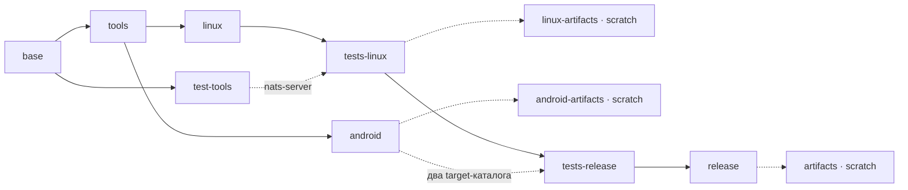

# Релизы Core

Core поставляет готовую `libskvoz_core.so` и Rust/C SDK для трёх отдельных targets:
`x86_64-unknown-linux-gnu`, `aarch64-linux-android` и `x86_64-linux-android`.
Версия Core остаётся `5.0.0`, C ABI — `1`. Android-профили и закреплённые
NDK/Rust инструменты описаны в [Android supplier](android-supplier.md).
Проверка Android loader, JNI и APK принадлежит потребителю.

## Автоматическая поставка

Workflow [Core](../.github/workflows/core.yml) содержит два job: `build` и `publish`.
Первый вызывает Buildx с [Dockerfile](../docker/rust/Dockerfile) и экспортирует готовые файлы.
Общий `base` готовит закреплённый Rust 1.92.0 на Debian Bookworm и системные
инструменты. `tools` один раз получает Cargo dependencies и собирает host-упаковщик;
Linux и Android наследуют эти слои независимо. NATS для native-тестов готовится
в отдельном `test-tools`, который Android не использует.

Сплошная стрелка ниже — `FROM`, пунктирная — выборочный `COPY --from`:



`tests-linux` проверяет engine, runtime, contracts, ABI, настоящих binary consumers,
отказы binding по identity/digest, настоящий TLS/NATS startup и IPC HELLO готового
daemon, а также обычные tools-тесты. Core runtime-сценарии выполняются с
`fault-injection` и собственными локальными брокерами; production ABI этот feature
не использует:
SDK allowlist и Android scheduling с mock-инструментами. Ему не нужны NDK и Android
artifacts. `android` готовит оба закреплённых target последовательно и проверяет
их профиль, ELF/dependencies, ABI, hashes и SDK при упаковке. Linux ABI, daemon
и native-тесты не входят в его зависимости.

`tests-release` объединяет уже проверенный Linux artifact с двумя Android trees.
Только здесь запускаются ignored-проверка реальной упаковки Linux/Android и
release-contract со всеми тремя targets и mock GitHub. Обычные tools-тесты
повторно не запускаются. `release` наследует этот этап, поэтому полный bundle
требует успеха всех обязательных проверок. Он архивирует готовые библиотеки и
daemon и создаёт `SHA256SUMS`. Финальный `artifacts` содержит только три архива,
checksums и publisher для внутренней передачи в job публикации; builder, registry,
NDK, NATS и тестовые зависимости в `scratch` не копируются.

Fetch и host-tool build имеют отдельные общие слои. Registry и Cargo outputs
сохраняются в `/out`; Cargo-сборки обеих веток используют `--offline`. Android
NDK/std подготавливаются отдельно по закреплённым pins. Полный
read-only source bind участвует в cache key: изменение исходников может
инвалидировать fetch, отдельной синтетической Cargo workspace для cache нет.
BuildKit может выполнять независимые ветки параллельно.

Исходники и Git metadata монтируются только для чтения. Сборка и тесты работают
от `nobody:nogroup` с `no-new-privileges`; только установка инструментов выполняется
от root. Запись идёт в `/out`. Cargo работает в `/src/src`, а полный repository context
монтируется read-only в `/src`; Git и source receipt используют корень репозитория.
BuildKit управляет жизненным циклом сборки.
Build job ограничен 90 минутами, подготовка Android и каждый target — 900 секундами,
publish job — 10 минутами.
Это среда GitHub runner; локальные ресурсные ограничения задаются отдельно.

Pull request проходит ту же цепочку и получает временный CI artifact. Push в `main` или ручной
запуск `workflow_dispatch` для `main` в `skvoz-project/skvoz-core` дополнительно
запускает отдельную публикацию. Только эта job имеет `contents: write`;
`GH_TOKEN` передаётся только шагу публикации.

Тег содержит полный SHA именно того commit, из которого собраны outputs:

```text
core-v5.0.0-<40-символьный-SHA>
```

Релиз содержит четыре assets:

- `skvoz-core-5.0.0-x86_64-unknown-linux-gnu.tar.gz`;
- `skvoz-core-5.0.0-aarch64-linux-android.tar.gz`;
- `skvoz-core-5.0.0-x86_64-linux-android.tar.gz`;
- `SHA256SUMS` с SHA256 всех трёх архивов.

Архив имеет плоский корень: `artifact.json`, `lib/libskvoz_core.so`, `sdk/`,
`source-inputs.sha256`, `LICENSE-async-nats`, `PATCHES-async-nats.md`.
Linux также содержит `bin/skvoz-core-daemon`. Собственная MIT-лицензия находится
в `sdk/LICENSE`. `artifact.json` сохраняет target, ABI, версии инструментов,
библиотечный digest, SDK/source inventory hashes и `source.revision` с полным SHA.
Исходники supplier не входят в архив; их inventory связывает output с owning commit.

Перед публикацией инструмент заново проверяет все три архива, manifests,
библиотечные digest, полное множество файлов SDK и `SHA256SUMS`. Тег создаётся атомарно с указанным SHA, затем публикация требует его наличия
через `--verify-tag`. Уже существующий тег, в том числе появившийся при
одновременном запуске, завершает запуск ошибкой. Повторный запуск не дополняет существующий релиз,
не заменяет assets и не передвигает тег. Релиз не помечается `latest`.
При частичном сбое публикации нужна отдельная проверка состояния GitHub;
автоматического удаления или исправления существующего релиза нет.

## Явная упаковка

Обычные команды `package` и `package-android` сохраняют локальный candidate с
`source.revision: null`. Для релизной сборки checkout должен быть чистым, а
`SKVOZ_CORE_SOURCE_REVISION` — совпадать с его полным `HEAD`. Dockerfile получает
это значение через build argument `SOURCE_REVISION`; `.dockerignore` сохраняет
Git metadata и все публичные исходники, исключая локальные и производные файлы:

Команды упаковщика ниже выполняются из `src/`, где находится Cargo output.

```sh
export SKVOZ_CORE_SOURCE_REVISION="$(git rev-parse HEAD)"
# Выполните команды сборки/упаковки Linux и Android из инструкций supplier.
./target/release/skvoz-core-tools archive "$LINUX_ARTIFACT" "$SKVOZ_CORE_SOURCE_REVISION" "$RELEASE_DIRECTORY"
./target/release/skvoz-core-tools archive "$ANDROID_ARM64_ARTIFACT" "$SKVOZ_CORE_SOURCE_REVISION" "$RELEASE_DIRECTORY"
./target/release/skvoz-core-tools archive "$ANDROID_X64_ARTIFACT" "$SKVOZ_CORE_SOURCE_REVISION" "$RELEASE_DIRECTORY"
./target/release/skvoz-core-tools checksums "$RELEASE_DIRECTORY" "$SKVOZ_CORE_SOURCE_REVISION"
```

Передайте переменную ревизии до упаковки всех трёх targets. Команды не меняют
готовые native bytes и не перезаписывают существующие outputs. Нельзя присваивать
старому локальному candidate новый SHA: библиотека, SDK и inventory должны быть
получены из указанного commit. `publish` предназначен для доверенной GitHub job
и дополнительно проверяет repository, event, `main` и `GITHUB_SHA`.

## Отдельные платформенные цели

Из чистого owning commit можно получить candidate для выбранной платформы,
не собирая другую. Выполняйте следующие Docker-команды из корня репозитория.
Context — корень репозитория с Git metadata; host platform остаётся
`linux/amd64`, включая cross-compile для Android:

```sh
export SOURCE_REVISION="$(git rev-parse HEAD)"
docker buildx build --platform linux/amd64 --file docker/rust/Dockerfile \
  --target linux-artifacts --build-arg SOURCE_REVISION="$SOURCE_REVISION" \
  --output type=local,dest=src/target/core-linux .
docker buildx build --platform linux/amd64 --file docker/rust/Dockerfile \
  --target android-artifacts --build-arg SOURCE_REVISION="$SOURCE_REVISION" \
  --output type=local,dest=src/target/core-android .
```

Выберите нужную команду. `linux-artifacts` выдаёт
`src/target/core-linux/x86_64-unknown-linux-gnu/` с готовой библиотекой, SDK, manifests
и `bin/skvoz-core-daemon` после Linux-проверок. `android-artifacts` выдаёт только
`aarch64-linux-android/` и `x86_64-linux-android/` под `src/target/core-android/` после
supplier-проверок упаковщика. Загрузка Android/JNI остаётся отдельной проверкой
потребителя. Эти цели не выполняют cross-target/release-contract и не создают
полный публикуемый релиз. CI выбирает `--target artifacts`: только эта цель
объединяет все три targets, обязательные проверки и immutable release bundle.

## Получение определённого релиза

Выберите существующий точный тег, без поиска последнего релиза:

```sh
CORE_TAG='core-v5.0.0-<полный-SHA>'
mkdir core-download
cd core-download
gh release download "$CORE_TAG" --repo skvoz-project/skvoz-core \
  --pattern '*.tar.gz' --pattern SHA256SUMS
sha256sum --check --strict SHA256SUMS
```

Потребитель сохраняет точный release URL и SHA256 выбранного архива, проверяет
внутренние manifests, owning repository/revision, target/ABI, SDK inventory и
библиотеку, затем устанавливает готовые bytes. Отсутствие архива или ошибка
проверки завершают обновление; скрытой пересборки Core нет. Автоматические
команды обновления pins принадлежат соответствующему репозиторию потребителя.
До первого опубликованного релиза локальные pins остаются локальными; URL и
будущие hashes появляются после фактической публикации.
